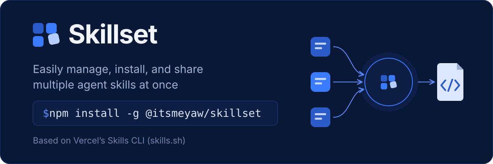

<div align="center">



[](https://www.npmjs.com/package/@itsmeyaw/skillset)
[](https://github.com/itsmeyaw/skillset/actions/workflows/ci.yml)
[](https://nodejs.org)
[](LICENSE)

[Features](#features) • [Installation](#installation) • [Quick start](#quick-start) • [Commands](#commands) • [Skillset file](#skillset-file-format)

</div>

Skillset is a CLI for curating agent skills into a pinned, shareable list and installing that list into any project in one step. It wraps [Vercel's Skills CLI](https://github.com/vercel-labs/skills) ([skills.sh](https://skills.sh)), so skills land in the same agent directories and the same `skills-lock.json` file that `npx skills` uses.

## Features

- **Pinned to commits**: every skill records the exact Git commit it came from, so an install gives you exactly what you reviewed until you run `update`.
- **One list, every project**: keep a named Skillset in your home directory, or commit `./skillset.json` so your team shares it.
- **Mix sources**: combine skills from several repositories, branches, tags, or Git URLs into one Skillset.
- **Works with your agents**: installs for Universal agents (`.agents/skills`), Claude Code, and any detected agent by default, or for any agent you pick.
- **Interactive or scripted**: run a command without arguments to be prompted, or pass flags. `-y` skips every prompt.
- **Safe by default**: an install only adds skills. Skills that aren't in the Skillset are never removed.

## Installation

You need [Node.js](https://nodejs.org) 22.20.0 or later and [Git](https://git-scm.com).

```sh
npm install -g @itsmeyaw/skillset
```

Or run it without installing:

```sh
npx @itsmeyaw/skillset --help
```

## Quick start

Build your Skillset once, then install it in every project.

<p align="center">
  
</p>

**1. Create your Skillset.** `--set my-set` names a Skillset you can use from any project:

```sh
skillset add --set my-set
```

You are asked for:

1. **Source?** Type a repository such as `mattpocock/skills`.
2. **Which skills?** Search and tick the skills you want.
3. **Add another source?** Answer `y` to mix in skills from more repositories, or `n` when you're done.
4. **Install skillset?** Answer `n` for now.

`skillset ls --set my-set` shows what is in it.

**2. Install it in any project.** From each project that should get the skills:

```sh
cd ~/projects/some-project
skillset install my-set
```

You are asked which skills, which agents, project or global scope, and symlink or copy, then to confirm.

**3. Keep it fresh.** Nothing changes until you update the pins:

```sh
skillset update --set my-set   # move pins to the latest commits
skillset rm --set my-set       # pick skills to drop
```

Re-run `skillset install my-set` in a project to pick up the changes.

> [!TIP]
> Coming from `npx skills add`? Add skills from one repository and install the whole Skillset in one command:
>
> ```sh
> skillset add mattpocock/skills -s grilling --install
> ```
>
> Leave out `--set` to use `./skillset.json` in the current project, which you can commit so your team shares it.

## Concepts

| Term          | Meaning                                                                                     |
| ------------- | ------------------------------------------------------------------------------------------- |
| Skillset      | A shareable list of skills to install together, stored as a JSON file.                      |
| Entry         | One skill in a Skillset: its name, Source, and Pin.                                         |
| Source        | Where a skill comes from, such as `owner/repo`.                                             |
| Pin           | The exact commit of the Source that an Entry was taken from.                                |
| User Skillset | A Skillset kept by name outside any project, such as `my-set`, so every project can use it. |

`add`, `remove`, and `update` only change a Skillset. `install` only installs one. `add --install` runs both steps, one after the other.

## Commands

| Command                    | Description                                                            |
| -------------------------- | ---------------------------------------------------------------------- |
| `add [source]`, `a`        | Pin skills from a Source to the Skillset; `--install` also installs.   |
| `remove [skills...]`, `rm` | Remove skills from the Skillset (`--all` removes everything).          |
| `update [skills...]`, `up` | Move pins to the latest commits. Sources pinned to a version are kept. |
| `list`, `ls`               | Show Entries, or User Skillset names with `--user`.                    |
| `install [set]`, `i`       | Install the Skillset at its Pins.                                      |

Every command accepts `--set <value>` (default `./skillset.json`) and `--help`. `add` creates the Skillset file if it is missing. `install [set]` takes a name, `.json` path, or HTTPS URL, but you can't combine it with `--set`.

| Flag                 | Used by          | Description                                                             |
| -------------------- | ---------------- | ----------------------------------------------------------------------- |
| `-s, --skill <name>` | `add`, `install` | Select skills from the Source for `add`, or Entries for `install`.      |
| `--all`              | `add`            | Select all skills from the Source.                                      |
| `-l, --list`         | `add`            | List available skills without writing.                                  |
| `--install`          | `add`            | After adding, install the whole Skillset.                               |
| `-a, --agent <id>`   | `add`, `install` | Select agents; on `add`, requires `--install`.                          |
| `-g, --global`       | `add`, `install` | Install globally instead of per project; requires `--install` on `add`. |
| `--copy`             | `add`, `install` | Copy instead of symlinking; requires `--install` on `add`.              |
| `-y, --yes`          | `add`, `install` | Skip prompts in both steps.                                             |
| `--user`             | `list`           | List User Skillset names; cannot be combined with `--set`.              |

To select several skills or agents, repeat the flag or list the names after it. For `install`, when the last `-s` has multiple space-separated values and no other Skillset is given (a positional name or `--set`), the final value is treated as the Skillset name. To select multiple skills from the default Project Skillset, repeat `-s` (for example, `install -s alpha -s beta`) or use `--set ./skillset.json`. If you decline or a `--install` step fails, the added Entries stay in the Skillset.

Without `-a`, installs go to Universal agents (`.agents/skills`), Claude Code, and any detected agent. `-y` and non-interactive runs use these defaults without asking.

### Sources

- `owner/repo`
- `owner/repo#branch`
- `owner/repo@v1.2.3` or `owner/repo@<full-sha>`
- GitHub tree URLs
- Other remote Git URLs

Quote sources that contain `#` in your shell. Private repositories use your existing Git credentials. Local paths and direct downloads cannot be pinned.

### User Skillsets

Pass a bare name to `--set` (or to `install`) to keep a Skillset outside any project:

```sh
skillset add mattpocock/skills -s grilling --set my-set
skillset install my-set
skillset ls --user   # list your User Skillsets
```

They are stored in the first of `$SKILLSET_HOME`, `$XDG_CONFIG_HOME/skillset`, or `~/.skillset`. To use a file in the current directory instead, give a path ending in `.json`, such as `skillset install ./team.json`.

> [!IMPORTANT]
> Put the Skillset name before `-s`, as in `skillset install my-set -s grilling`. Otherwise it is read as another skill name. Likewise, put it before `-a` if the name matches a supported agent ID.

### Remote Skillsets

Install a published Skillset directly from an HTTPS URL:

```sh
skillset install https://example.com/team.json
skillset install --set https://github.com/owner/repo/blob/main/skillset.json -y
```

GitHub blob links are converted to raw URLs. Remote Skillsets are fetched on every install, never saved, and can be listed with `ls --set <url>` but cannot be edited. Interactive installs show the Entries and ask for confirmation. Use `-y` for unattended installs. Only HTTPS URLs are supported, with no authentication; downloads are limited to 1 MB and 10 seconds.

## Skillset file format

```json
{
  "$schema": "https://raw.githubusercontent.com/itsmeyaw/skillset/main/schemas/skillset/v1.json",
  "skills": [
    {
      "name": "grilling",
      "source": "mattpocock/skills",
      "commit": "5863806dd4e15c63174bee4e7515a4256792ecfa"
    }
  ]
}
```

Point your editor at the [JSON Schema](schemas/skillset/v1.json) for validation and completion.

## Shell completions

Print a completion script for `bash`, `zsh`, `fish`, `sh`, `powershell`, or `pwsh`:

```sh
skillset --completions zsh > ~/.zfunc/_skillset
```

## Telemetry

> [!NOTE]
> Skillset collects no data itself. However, the [Vercel Skills CLI](https://github.com/vercel-labs/skills) library it uses sends anonymous usage telemetry by default. See [what is collected](https://github.com/vercel-labs/skills/blob/main/docs/troubleshooting.md#telemetry).

To turn it off, set `DISABLE_TELEMETRY=1` or `DO_NOT_TRACK=1`:

```sh
DISABLE_TELEMETRY=1 skillset install my-set
```
